# Diagrams — showcase

Mermaid and PlantUML, every diagram type worth exercising. Kept as a real `.md`
asset so `render_check.py` validates the exact file the demo renders.

**Mermaid** renders in the page. A diagram it cannot parse gets an error diagram
injected into the DOM, but the diagram *source* is destroyed by that path — so if
one of these fails, the text below is the only copy.

**PlantUML** renders on `plantuml.com` and comes back as an image. A syntax error
returns HTTP 400 whose body is itself a *renderable* error picture, so a broken
diagram still displays at full size looking deliberate. Only reading the response
body — which `render_check.py --plantuml` does — tells the two apart.

---

## 1. Mermaid

### 1.1 Flowchart — shapes and edge styles

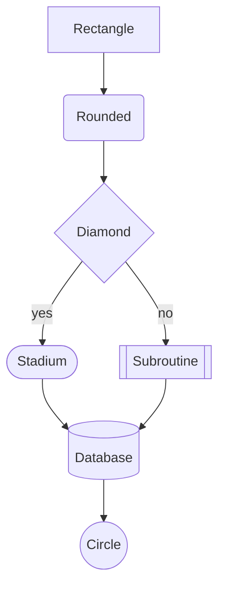

### 1.2 Flowchart — subgraphs and directions

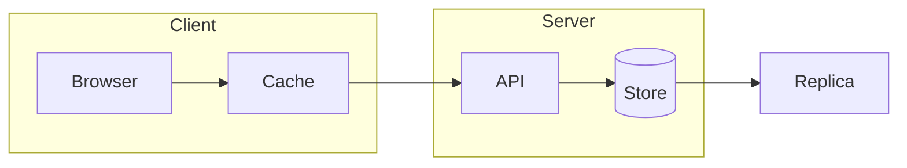

### 1.3 Sequence diagram

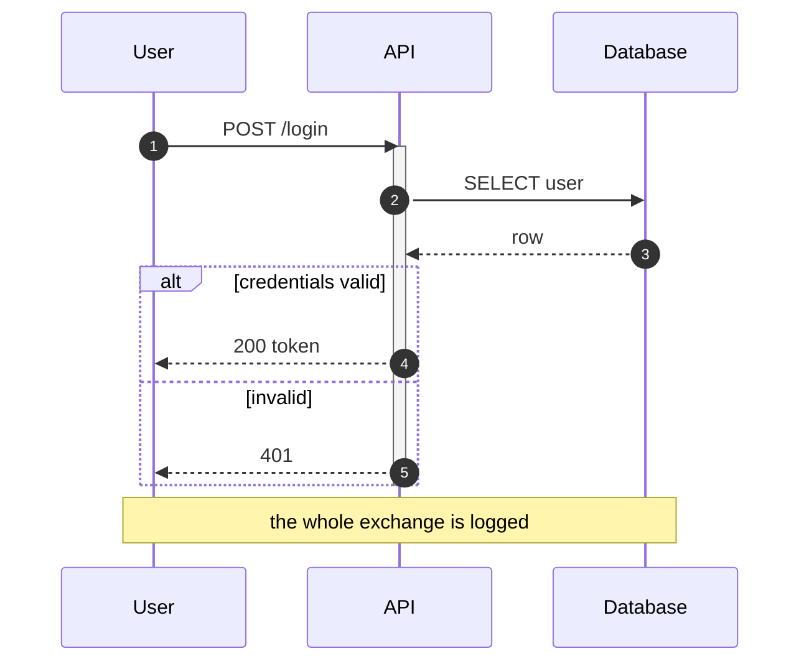

### 1.4 Class diagram

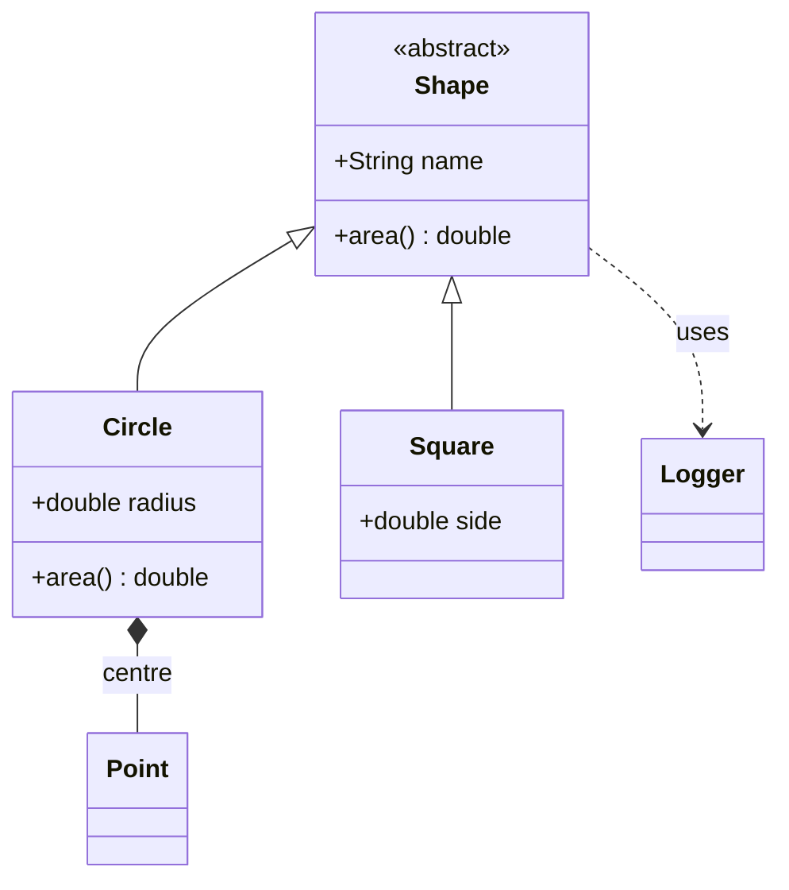

### 1.5 State diagram

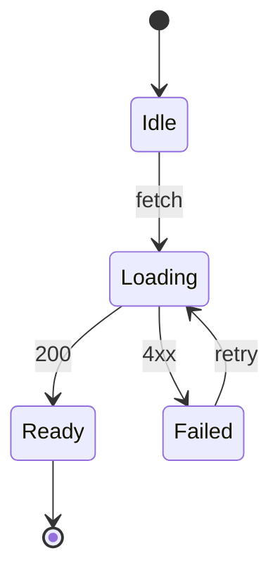

### 1.6 Entity relationship

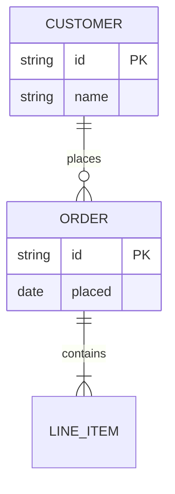

### 1.7 Gantt

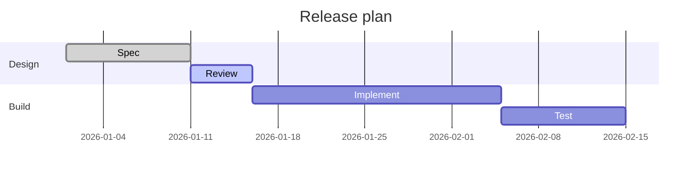

### 1.8 Pie

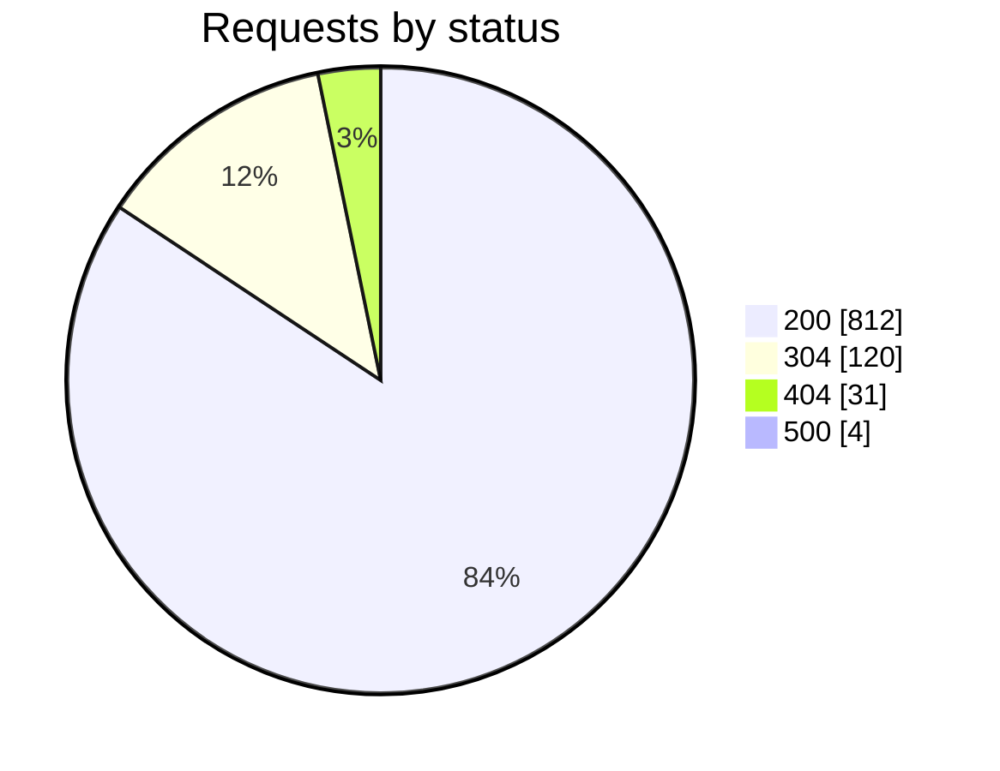

### 1.9 Git graph

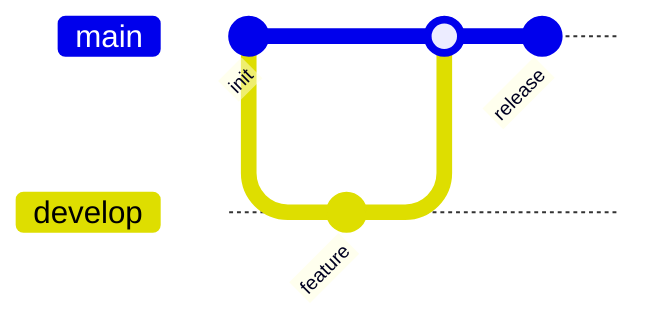

### 1.10 Mindmap

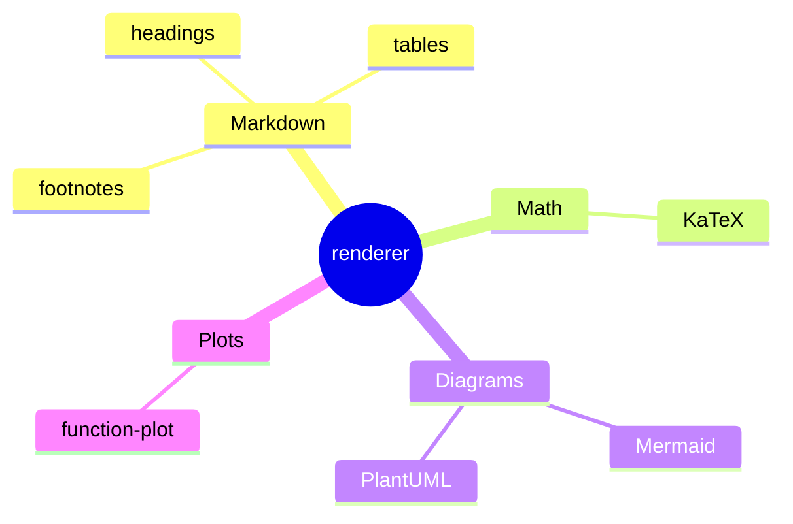

### 1.11 Timeline

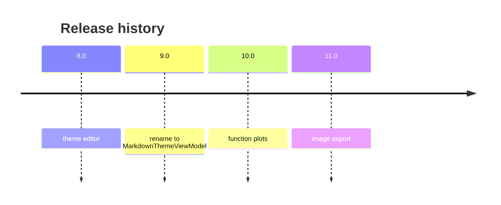

### 1.12 Quadrant chart

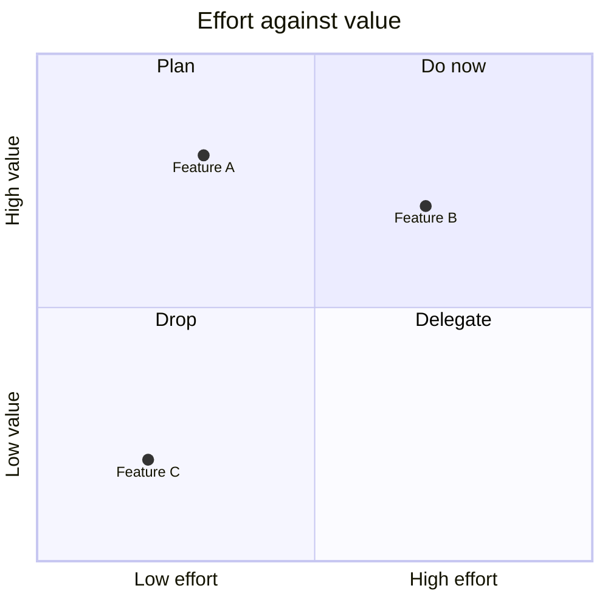

### 1.13 XY chart

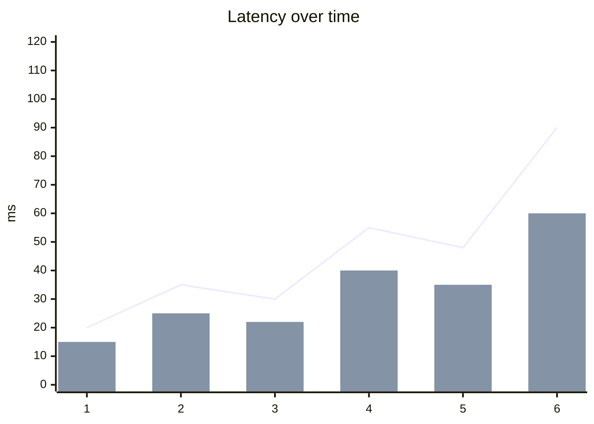

### 1.14 A diagram with CJK and punctuation in its labels

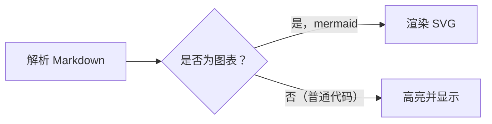

### 1.15 A diagram with HTML in its labels

Mermaid's `htmlLabels` option is on by default, so these labels become a
`<foreignObject>` — which the PNG export has to render. It does; that was
measured, not assumed.

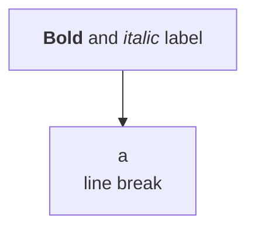

### 1.16 A deliberately broken diagram

Mermaid replaces this with its own error diagram, reading *Syntax error in text*.

```mermaid
graph TD
    A[Start --> B{Unclosed
```

### 1.17 A misspelled info string is not a diagram at all

`mermiad` matches nothing, so this renders as a plain highlighted code block —
silently, with no warning anywhere.

```mermiad
graph TD
    A --> B
```

---

## 2. PlantUML

### 2.1 Sequence

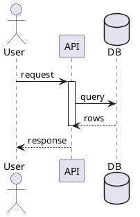

### 2.2 Use case

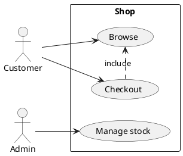

### 2.3 Class

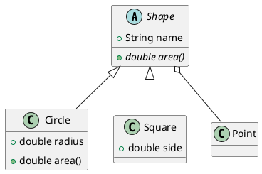

### 2.4 Activity, modern syntax

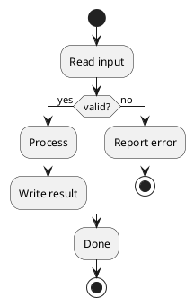

### 2.5 Component

```plantuml
@startuml
package "Client" {
  [Browser] as B
}
package "Server" {
  [API] as A
  [Worker] as W
  database "Postgres" as P
}
B --> A : HTTPS
A --> P : SQL
A --> W : enqueue
@enduml
```

### 2.6 State

```plantuml
@startuml
[*] --> Idle
Idle --> Loading : fetch
Loading --> Ready : 200
Loading --> Failed : 4xx
Failed --> Loading : retry
Ready --> [*]
@enduml
```

### 2.7 Object

```plantuml
@startuml
object "shape: Circle" as c {
  radius = 3.0
}
object "point: Point" as p {
  x = 1
  y = 2
}
c --> p : centre
@enduml
```

### 2.8 Mindmap

```plantuml
@startmindmap
* renderer
** Markdown
*** headings
*** tables
** Math
*** KaTeX
** Diagrams
*** Mermaid
*** PlantUML
@endmindmap
```

### 2.9 Work breakdown structure

```plantuml
@startwbs
* Release
** Design
*** Spec
*** Review
** Build
*** Implement
*** Test
@endwbs
```

### 2.10 Gantt

```plantuml
@startgantt
Project starts 2026-01-01
[Spec] lasts 10 days
[Review] lasts 5 days
[Review] starts at [Spec]'s end
[Implement] lasts 20 days
[Implement] starts at [Review]'s end
@endgantt
```

### 2.11 Timing

```plantuml
@startuml
robust "Web Browser" as WB
concise "Web User" as WU
WB is Idle
WU is Idle
@0
WB is Processing
@100
WB is Waiting
@300
WB is Idle
@enduml
```

### 2.12 A deliberately broken diagram

PlantUML answers this with HTTP 400. The body is a renderable error picture, so
the preview shows it at full size as if it were fine — which is exactly why the
validator reads the response body instead of trusting the image.

```plantuml
@startuml
this is not valid plantuml at all !!!
@enduml
```

### 2.13 An empty diagram renders a welcome placeholder

`@startuml` / `@enduml` with nothing between them returns HTTP 200 and the
"Welcome to PlantUML!" image. No error, but not a diagram either.

```plantuml
@startuml
@enduml
```
