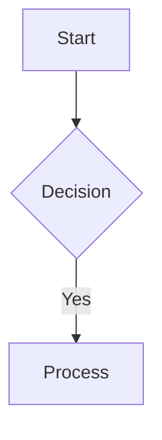
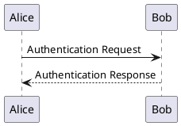

# AvalonMarkdown document authoring

## Why this skill exists

AvalonMarkdown renders Markdown through a markdown-it pipeline in a WebView. Its
feature set is wider than CommonMark — math, diagrams, function plots, video
embeds — and each extension has rules that are *not* discoverable by guessing.

The more important reason is that **this renderer fails quietly**. A document with
broken math, a broken diagram and a broken plot can render with no console
message, no error event and no visual clue beyond the thing you were trying to
draw being absent. Three concrete mechanisms:

- KaTeX is invoked with `throwOnError: false`, so it builds its own error span and
  never throws or logs. The renderer's own error handling is never reached.
- PlantUML is fetched as an ``; a rejected diagram comes back as a
  *renderable error picture*, so it loads at full size and looks deliberate.
- A `plot` fence whose JSON is malformed produces an inline error block and logs
  nothing at all.

So the rule for this document set is: **validate before publishing, and never
assume a silently-absent element means "not used".**

## Validate before publishing

```bash
python skills/avalonmarkdown-syntax/scripts/render_check.py doc.md
```

With a build present this runs both tiers — static analysis, then a real render
through the same WebView pipeline the preview uses. It exits `0` on a clean
document and `1` on findings. Add `--no-render` for a fast structural pass while
writing, and `--json` for machine-readable output.

A static-only pass prints `PASS (static only)` and an explicit warning, because it
**cannot** prove a formula compiles or a diagram parses. Do not read a static pass
as a full pass.

---

## Members with sharp edges

These four are where documents actually break. The rest are ordinary Markdown —
see [references/members.md](references/members.md) for the full table.

### Math (KaTeX)

Inline math uses single dollars, display math uses a doubled pair on its own lines.

````markdown
Inline: $E = mc^2$

$$
x = \frac{-b \pm \sqrt{b^2 - 4ac}}{2a}
$$
````

**A single dollar only opens math when the character before it is not a word
character and the closing dollar's following character is not one either.** A
"word character" here is ASCII `[A-Za-z0-9_]` — CJK counts as a non-word
character, which is why `中$x$` works.

| Write | Result | Why |
| --- | --- | --- |
| `$x$y` | renders literally as `$x$y` | the closing `$` is followed by a word character |
| `a$b$` | renders literally as `a$b$` | the opening `$` is preceded by a word character |
| `Price is $5` | literal `$5` | `$` followed by `5` cannot close, so it stays text |
| `Total $$ here` | **`Total  here`** — both dollars silently deleted | a doubled dollar mid-line hits a branch that appends an empty string |
| `$$` block with no closing `$$` | **the entire rest of the document is swallowed** into the math expression | the block scanner advances past the document even when it finds no closer |

The last two are the dangerous ones, and neither produces an error. Always close
a `$$` block, and never write `$$` inline.

To *show* a dollar sign, escape it: `\$`.

### Mermaid

````markdown

````

The fence info string is matched **exactly**, after trimming and lower-casing.
`mermaid {theme=dark}` does not dispatch; a typo like `mermiad` dispatches nothing
and silently becomes a highlighted code block. Both look like "the diagram just
didn't appear".

When a diagram is genuinely malformed, Mermaid injects an error diagram reading
*Syntax error in text* — and **destroys the diagram source in the process**. If you
need to fix a failing diagram, keep the original text; you cannot recover it from
the preview.

### PlantUML

````markdown

````

The body must be wrapped in `@startuml` / `@enduml`. `puml` is accepted as an alias
of `plantuml`.

Two failure modes, neither of which reports anything in the preview:

- **Syntax error** — the server answers `400` with a body that is *itself a
  valid image* containing the words "Syntax Error?". The preview displays it at
  normal size. A diagram that is broken looks like a diagram that drew — just the
  wrong one. The validator catches this by reading the HTTP response body, which
  the browser cannot do.
- **Empty body** (bare `@startuml` / `@enduml`) — the server returns `200` with
  its "Welcome to PlantUML!" placeholder, which also renders as a normal image.

### Function plots

````markdown
```plot
{
  "title": "sin(x)/x",
  "grid": true,
  "xAxis": { "domain": [-12, 12] },
  "data": [
    { "fn": "sin(x)/x" },
    { "fn": "cos(x)", "color": "#e06c75" }
  ]
}
```
````

The body is the raw [function-plot](https://mauriciopoppe.github.io/function-plot/)
options object. A single JSON **object** is required — an array or scalar is
rejected. Only two things are defaulted, and your JSON always wins: a series
colour (taken from the theme palette by position) and `disableZoom` (defaults to
`true`, keeping the wheel for page scrolling).

Things that will bite you, all measured:

| Rule | Detail |
| --- | --- |
| **Constants are upper-case** | `PI`, `E`. Lower-case `pi` / `e` are undefined, and the curve simply does not appear — no error. |
| Function names | `sin` `cos` `tan` `asin` `acos` `atan` `sqrt` `abs` `exp` `log` `ln` `max` `min`. `floor` and `sign` do **not** exist. |
| Expression characters | Digits, letters, `_ + - * / ^ ( ) . ,` whitespace, and `% ? : < > = !`. Anything else — quotes, brackets, braces, `\|`, `;` — is rejected before the library sees it. |
| Piecewise works | Comparison and ternary operators are allowed: `"fn": "x > 0 ? x : -x"` is valid and evaluates pointwise. |
| `width` / `height` include the margins | Margins are left 40, right 20, bottom 20, top 20 (top 40 with a `title`). `"height": 350` gives a 310px plot area. |

Omit `width` and it fits the container, which is usually what you want.

---

## Ordinary members

Full syntax table: [references/members.md](references/members.md).

**Headings get automatic anchors.** Every heading receives a slug `id`, so
`[see §2](#2-math)` jumps within the document. The slug is the heading text,
lower-cased, with everything that is not a Unicode letter, number, `_`, whitespace
or `-` removed, then runs of whitespace/underscore collapsed to `-`. Duplicate
headings get `-1`, `-2` appended in order. CJK headings are linkable — punctuation
and emoji are not.

**Links.** `#anchor` links jump in-place. Everything else is handed to the host
application via a `LinkClicked` event, and only opens a browser if the app does not
handle it. Bare URLs are auto-linked.

**Underline has no Markdown syntax** — it needs raw HTML, `<u>like this</u>`, which
works because the renderer passes HTML through unescaped. The same passthrough
means `<details>`, `<span style="…">` and an explicit `<a id="target"></a>` all
work.

**Task lists** render as disabled checkboxes — they display state, they are not
interactive.

**Footnote references and back-links** (`[^1]`, the `↩︎` return arrow) work
natively, because they are ordinary in-page anchors.

**Video.** A `video` fence takes a bare URL. In ordinary Markdown, an image whose
URL is a known video page or a video file becomes a player instead of an image.
YouTube, Bilibili and Vimeo are recognised; direct `.mp4`/`.webm`/`.ogg`/`.mov`/
`.avi`/`.mkv` links render as a `<video>` element. Platform videos render as a
click-to-play tile and only load the third-party player once clicked.

**Code fences.** A language name that highlight.js knows is highlighted; anything
else renders as plain text in a code block, which is not an error. Every block gets
a copy button and height controls.

---

## Checklist before publishing

1. Every `$$` block is closed — an unclosed one deletes the rest of the document.
2. No bare `$$` inside a line of prose.
3. Every `@startuml` has its `@enduml`.
4. Every `plot` body is one JSON object, with `PI`/`E` in upper case.
5. Fence info strings are spelled exactly: `mermaid`, `plantuml`, `plot`, `video`.
6. `render_check.py` reports no findings, with the render tier actually running.
