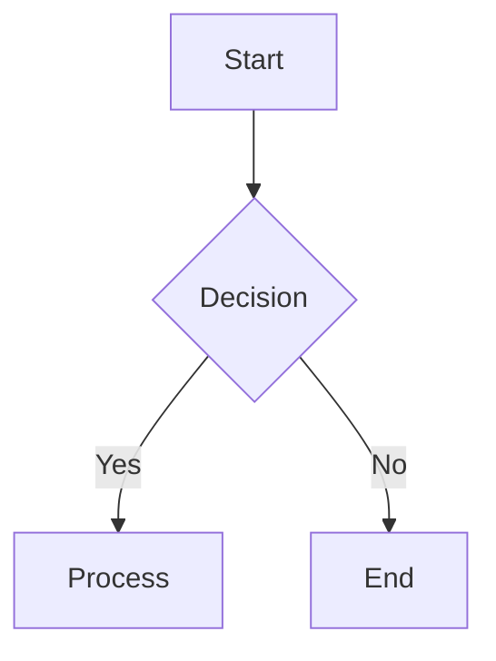
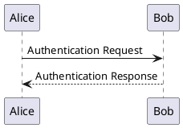

# Positive fixture

Every member the renderer supports, written the way the spec says to write it.
`render_check.py` must report **zero** findings here. If it does not, the checker
is producing false positives and the checker is what needs fixing.

## Headings and anchors

The link below resolves to the slug of the heading in the next section
(`## Math, inline and block` -> `math-inline-and-block`).

[Jump to the math section](#math-inline-and-block)

### Text formatting

**Bold**, *italic*, ~~strikethrough~~, `inline code`, and <u>underline via HTML</u>.

### Lists

- unordered item
- another item
  - nested

1. ordered item
2. second item

- [x] a completed task
- [ ] an outstanding task

### Tables and quotes

| Column | Meaning |
| --- | --- |
| `alpha` | first |
| `beta` | second |

> A blockquote.
> It continues on a second line.

---

## Math, inline and block

Inline math between single dollars: $E = mc^2$ and $\frac{a}{b}$.

A block between double dollars, with `@startuml`-free content:

$$
x = \frac{-b \pm \sqrt{b^2 - 4ac}}{2a}
$$

## Code

```python
def fibonacci(n):
    a, b = 0, 1
    for _ in range(n):
        yield a
        a, b = b, a + b
```

```json
{ "note": "a plain json fence stays a highlighted code block, never a chart" }
```

## Diagrams





## Function plots

Default colours come from the theme palette, so no `color` is needed here.

```plot
{
  "title": "sin(x)/x",
  "grid": true,
  "xAxis": { "domain": [-12, 12] },
  "yAxis": { "domain": [-0.4, 1.1] },
  "data": [
    { "fn": "sin(x)/x" },
    { "fn": "cos(x)" }
  ]
}
```

Piecewise definitions work: comparison and ternary operators pass the whitelist.
Note the upper-case `PI` — lower-case `pi` is undefined and the curve vanishes.

```plot
{
  "grid": true,
  "xAxis": { "domain": [-6, 6] },
  "data": [
    { "fn": "x > 0 ? x : -x", "color": "#e06c75" },
    { "fn": "sin(2*PI*x/6)" }
  ]
}
```

## Video

A platform URL becomes a click-to-play facade, not an iframe, until clicked.


## Footnotes and inline HTML

A statement needing support.[^note]

[^note]: The supporting note.

<details>
<summary>Collapsed HTML block</summary>
Hidden content.
</details>
