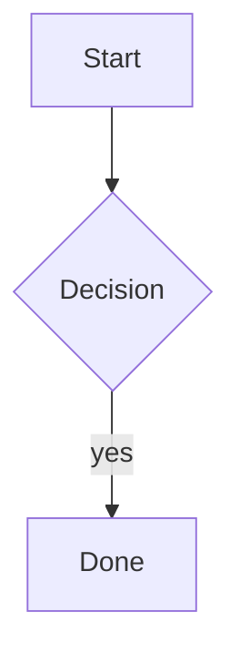
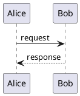
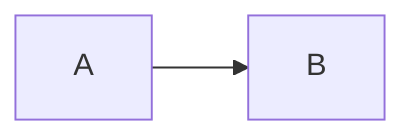

# Templates

Copy-paste-ready source for each member. Every block below is extracted and
rendered by `render_check.py` in CI-of-record (`--self-test` style validation of
this file), so what is written here is what renders — not what someone remembered.

Blocks are shown inside four-backtick fences, because several of them contain
three-backtick fences of their own.

Rules that apply to all of them:

- Fence info strings are matched **exactly** after trim + lower-case.
- Only `mermaid`, `plantuml`, `puml`, `plot` and `video` are intercepted.
  Everything else is a highlighted code block, which is never wrong, just not a
  diagram.
- Raw HTML passes through, so `<u>`, `<span style>`, `<details>` and `<a id>` work.

---

## Headings and anchors

````markdown
## 2. Text formatting

Jump targets are the heading text, lower-cased, with anything that is not a
letter, number, `_`, whitespace or `-` removed, and whitespace runs collapsed to
one `-`.

[See §2](#2-text-formatting)
````

Duplicate headings get `-1`, `-2` appended in document order, so the second
`## Setup` is `#setup-1`.

## Text

````markdown
**bold** *italic* ~~strikethrough~~ `inline code` <u>underline</u>
````

`<u>` is the only way to underline: Markdown has no syntax for it, and the
renderer passes HTML through.

## Links

````markdown
[External](https://example.com)
[In-page](#2-text-formatting)
[In-app routing](app://settings)
<https://auto.linked/url>
````

`#`-links jump in place. Everything else is handed to the host application, which
decides whether to open a browser. Bare URLs are auto-linked.

## Lists

````markdown
- item
  - nested
- [x] done
- [ ] outstanding

1. first
2. second
````

Task-list checkboxes are rendered **disabled** — they show state, they do not
capture input.

## Tables

````markdown
| Left | Centre | Right |
| :--- | :----: | ----: |
| a | b | c |

| With a pipe | Note |
| --- | --- |
| `a \| b` | escape it even inside code |
````

A `|` inside a cell must be `\|`, **even inside a code span** — the table parser
splits on pipes before inline markup is parsed.

## Blockquote and rule

````markdown
> quoted
> > nested

---
````

## Math

````markdown
Inline: $E = mc^2$

$$
x = \frac{-b \pm \sqrt{b^2 - 4ac}}{2a}
$$
````

**The safe way to write a dollar sign is `\$`.** An unescaped `$` that happens to
pair with another one becomes math, and a bare `$$` mid-line silently deletes two
characters. An unclosed `$$` block deletes the rest of the document — see
[SKILL.md](../SKILL.md#math-katex).

## Code

````markdown
```python
def f(n):
    return n * 2
```
````

An unknown language renders as plain escaped text in a code block, which is not an
error.

## Mermaid

````markdown

````

The most common mistake is a misspelled info string — `mermiad` renders as an
ordinary code block with no warning anywhere.

## PlantUML

````markdown

````

`@startuml` / `@enduml` are required. `puml` is accepted as an alias.

## Function plots

````markdown
```plot
{
  "title": "damped oscillation",
  "grid": true,
  "xAxis": { "domain": [0, 18.8] },
  "yAxis": { "domain": [-1.2, 1.2] },
  "data": [
    { "fn": "exp(-x/4)*sin(x)" },
    { "fn": "exp(-x/4)", "color": "#888888", "skipTip": true }
  ]
}
```
````

The body is **JSON**, so numbers only — `2*PI` is not valid JSON, write
`6.283185307179586`. Constants are upper-case (`PI`, `E`); lower-case `pi` is
undefined and the curve silently vanishes.

Piecewise curves use the ternary operator, which is allowed:

````markdown
```plot
{
  "title": "easeInOutQuad",
  "xAxis": { "domain": [0, 1] },
  "yAxis": { "domain": [0, 1] },
  "data": [
    { "fn": "x < 0.5 ? 2*x^2 : 1 - (-2*x + 2)^2/2" }
  ]
}
```
````

Non-`y = f(x)` graph types need `"sampler": "builtIn"`, and the parameter name
differs per type — `x` linear, `t` parametric, **`theta` polar**:

````markdown
```plot
{
  "title": "cardioid",
  "xAxis": { "domain": [-2.4, 2.4] },
  "yAxis": { "domain": [-2.4, 2.4] },
  "data": [
    { "fnType": "polar", "sampler": "builtIn", "r": "1 - cos(theta)" }
  ]
}
```
````

## Video

````markdown
```video
https://www.youtube.com/watch?v=YhKuZImznEE
```


````

YouTube, Bilibili and Vimeo page URLs become a click-to-play tile; the third-party
player loads only on click. A direct `.mp4` / `.webm` / `.ogg` / `.mov` / `.avi` /
`.mkv` link renders a `<video>` element.

## Footnotes

````markdown
A claim needing support.[^1]

[^1]: The supporting note.
````

## In-page anchor target

````markdown
<a id="custom-target"></a>

[Jump to it](#custom-target)
````

Useful when the generated heading slug is not what you want to link to.

---

## A complete document

Every member in one file, in the order the showcase pages use them.

````markdown
# Title

Intro with **bold**, `code` and a [link](https://example.com).

## Math

Inline $a^2 + b^2 = c^2$, and block:

$$
\int_0^1 x^2 \, dx = \frac{1}{3}
$$

## Table

| Col | Value |
| --- | --: |
| a | 1 |

## Diagram



## Plot

```plot
{
  "grid": true,
  "xAxis": { "domain": [-6, 6] },
  "data": [ { "fn": "sin(x)" } ]
}
```

## Footnote

See the note.[^n]

[^n]: Note text.
````
